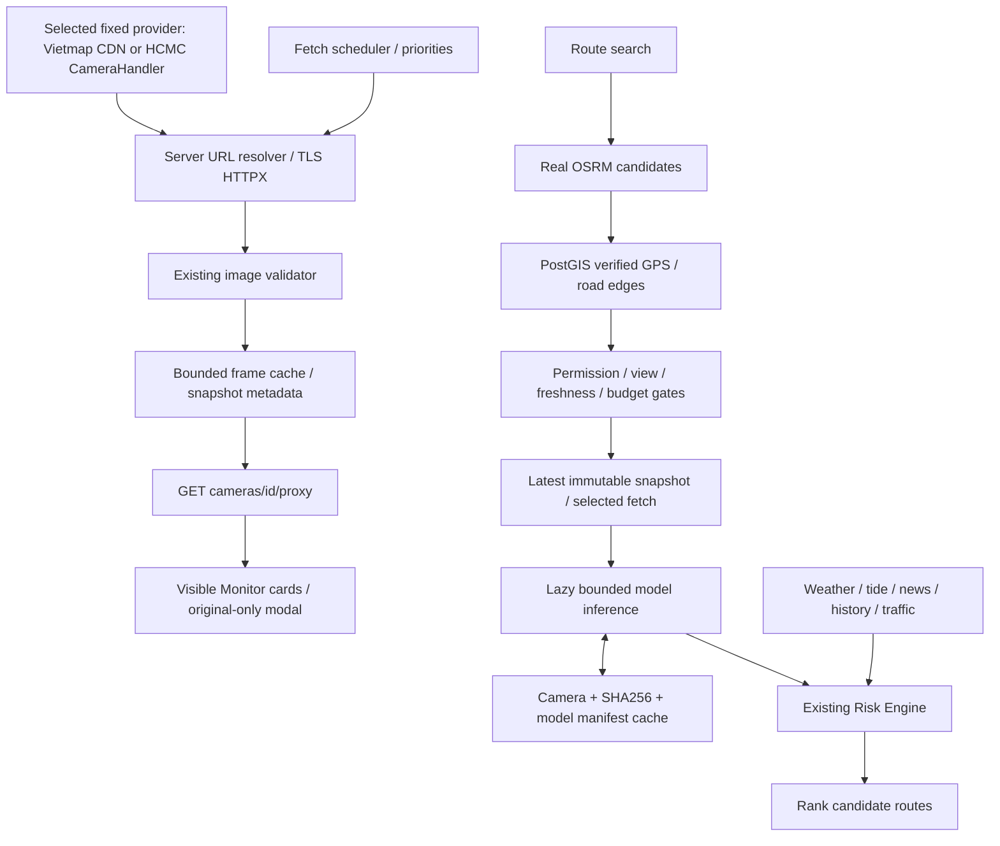

# Camera proxy first — route-only AI

## Architecture and dependency map

Previously, every new valid scheduled snapshot entered the persistent vision queue. A background consumer loaded models and wrote city-wide AI evidence regardless of whether a route needed it. Monitor displayed enhanced/analyzed images and AI counters.

Now fetching and viewing terminate at validated original images. Only a real OSRM route search may request bounded visual evidence, before risk scoring and ranking. Historical queue jobs are not consumed. No models or schema have been deleted.



## Reference implementation

Inspected upstream `proxy.php`, `camera.php`, `index.html`, `data-camera.json`, `README.md`, and `composer.json` at [ePlus-DEV/camera](https://github.com/ePlus-DEV/camera) on 2026-11-08. The PHP proxy accepts a 24-character hex ID, requests a fixed HTTPS camera handler with ID and timestamp, validates status/MIME, and returns image bytes. The browser refreshes images periodically. The detail page checks membership in its camera catalog; catalog SnapshotUrl values are not general proxy destinations.

SafePath implements these principles independently in Python/HTTPX, without PHP/Guzzle or copied source. `composer.json` declares MIT while HTML contains an all-rights-reserved notice; no assumption of permission to redistribute their source/assets is needed. Access to the upstream repository does not grant permission to use camera images.

## Camera fetch and proxy

`GET /api/v1/cameras/{cam_id}/proxy` checks a strict hex ID, database membership, `CAMERA_PROXY_ENABLED`, and existing viewing/ingestion permission settings. Clients cannot choose a URL. Only the selected fixed provider URL is allowed: Vietmap CDN by default, or the explicit HCMC CameraHandler option; redirects are rejected. No provider cookies/credentials are forwarded.

HTTPX streams original bytes with a total time budget, a response size limit, bounded concurrency, minimum request spacing, per-camera singleflight, negative caching and the existing portal circuit breaker. For HCMC the existing resolver supplies the canonical source URL and headers; Vietmap uses the fixed CDN snapshot path; the existing image validator rejects invalid magic, corrupt payloads and provider placeholders. MIME reflects the validated image format. No enhancement or inference is called.

Frames have a separate, bounded memory cache (default 32 frames, maximum 3 MB each, 20-second TTL). Repeated simultaneous viewers reuse the same in-flight request. Valid previous frames may be returned for up to 120 seconds after a fetch failure with `STALE` and their original retrieval time; invalid responses never replace them. Older frames are not served. Failures are cached for 60 seconds; 403/429 are respected, never retried via alternate URLs.

Response headers: `Cache-Control: no-store` (server owns freshness), `ETag`, `X-Content-Type-Options: nosniff`, `X-Camera-Source-Status`, `X-Retrieved-At`, `X-Snapshot-ID` (content hash), and `X-Upstream-Error` for stale fallback. Headers are exposed through CORS and forwarded by the existing Next.js API proxy. Capture time is not inferred from retrieval time: successful proxy images are `RECENTLY_RETRIEVED_CAPTURE_UNKNOWN`, never automatically `LIVE_VERIFIED`. Failures distinguish `OFFLINE`, `RESTRICTED`, `PLACEHOLDER` and `FETCH_FAILED`.

## Monitor

Monitor retains search, district/image filters, catalog statistics, camera names, location, original image, source/retrieval status, keyboard-accessible modal and reload controls. Its new components are separate from `CameraEvidenceModal`, preserving route/map consumers. Monitor does not request overlays, enhanced images or AI endpoints and shows no model counts or AI badges.

IntersectionObserver limits requests to visible images, with a shared frontend limit of four requests. Default refresh is 30 seconds, with 60 seconds and pause options. Hidden tabs abort image requests and suspend polling; returning resumes enabled refresh. Object URLs, listeners, timers and requests are cleaned up. Metadata polling also pauses when hidden. Opening a list of 100 cameras creates no inference jobs.

## Route on-demand evidence

`find_safe_route()` gets candidates from OSRM and batched PostGIS road/camera context, then calls `enrich_route_cameras()` before the existing segment Risk Engine and ranking.

Admission requires route-only mode, enabled route AI, ingestion and routing evidence permission, camera-level routing permission, verified coordinates/view provenance/line of sight and matching observed OSM way **and edge**. Proximity alone is insufficient. Retrieval and verified capture time must both be within 120 seconds. An unknown capture time cannot become current evidence merely by re-fetching. Snapshot hash is validated before model construction/inference; output must match the immutable snapshot hash. Model manifest identity forms part of the analysis cache key.

AI cache keys are `camera:route_ai:{camera_id}:{snapshot_sha256}:{model_version}` and remain separate from image caches and legacy camera metadata. Fresh results are reused. Model weights remain the existing vehicle/flood models and load lazily from route work. Inference runs outside the event loop with bounded native work; route timeout returns available routing evidence rather than waiting indefinitely. Missing models, invalid/stale images and timeout preserve `UNKNOWN`/insufficient evidence, not `SAFE`.

The existing Risk Engine remains responsible for evidence eligibility, weather/tide/news/history fusion, traffic status and risk ranking. No velocity is inferred from one frame and no flood depth from a mask ratio. Permissions are not enabled to make tests pass.

## Configuration and operation

Use the existing environment/bootstrap instructions in README. Do not publish local `.env` or provider cookies. `.env.example` and Compose document separate camera-viewing and route-AI settings. Defaults:

| Setting | Default |
| --- | --- |
| CAMERA_AI_MODE | route_only |
| ROUTE_CAMERA_AI_ENABLED | true |
| ROUTE_AI_MAX_CAMERAS | 4 |
| ROUTE_AI_MAX_CONCURRENCY | 2 |
| ROUTE_AI_TIMEOUT_SECONDS | 8 |
| ROUTE_AI_CACHE_TTL_SECONDS | 300 |
| ROUTE_AI_MAX_FRAME_AGE_SECONDS | 120 |
| CAMERA_PROXY_CACHE_TTL_SECONDS | 20 |
| CAMERA_PROXY_MAX_CONCURRENCY | 4 |
| CAMERA_PROXY_MAX_BYTES | 3000000 |
| CAMERA_PROXY_FAILURE_BACKOFF_SECONDS | 60 |

`CAMERA_INGESTION_PERMITTED` and `CAMERA_ROUTING_EVIDENCE_PERMITTED` retain their existing false defaults. `CAMERA_ALLOW_VIEW_ONLY` does not grant routing rights. Start/restart backend with these code/config changes; a running old backend is not evidence for the new implementation. No migration or model replacement is required.

## Files and validation

Implementation: `backend/app/main.py`, `core/config.py`, `schemas/contracts.py`, `services/{camera_proxy,route_camera_ai,routing,vision}.py`; `frontend/src/app/monitor/page.tsx`, `components/{CameraProxySnapshot,CameraProxyModal}.tsx`, `services/api.ts`, `types/contracts.ts`; `.env.example`, `docker-compose.yml`, `Antigravity.md`.

Tests: `backend/tests/test_camera_proxy_route_only.py`, route-AI tests, and Monitor Playwright specifications. Pre-existing untracked starter files `camera_live_proxy.py`, `route_ai_policy.py`, their tests and `ProxyCameraImage.tsx` are user work and were left intact.

Run from repository root:

```sh
.venv/bin/python -m pytest
cd frontend
npm run build
npx playwright test e2e/camera-modal-badge.spec.ts e2e/camera-60s-refresh.spec.ts --workers=1
```

Use `PLAYWRIGHT_BASE_URL` for the frontend and its configured backend. Unit fixtures exercise failure paths; they do not certify live provider access. Results and acceptance evidence are recorded below after execution.

## Operational limits

- Camera proxy frame/singleflight/pacing/circuit state is per process. Deploy a single backend worker at current budgets; multiple workers/replicas need shared Redis frame caching/leases/rate budgets to prevent multiplying upstream load. Route result caching/leases use Redis when available.
- Verified capture timestamps and view-to-road mappings may be unavailable in the real catalog. Such cameras remain viewable where permitted but cannot trigger/use route AI evidence.
- Native model inference cannot be forcefully stopped by an asyncio timeout. The route returns within its budget while the in-flight thread retains its bounded resource slot until completion.
- Provider 403/429, TLS/network failures, missing OSRM graph, unavailable PostGIS/Redis or missing model weights must remain visible as degraded states. No live availability, accuracy or memory/latency benchmark is implied by unit fixtures.

## Changed files

Added:

- `backend/app/services/camera_proxy.py`
- `backend/app/services/route_camera_ai.py`
- `backend/tests/test_camera_proxy_route_only.py`
- `backend/tests/test_route_camera_ai_only.py`
- `frontend/src/components/CameraProxySnapshot.tsx`
- `frontend/src/components/CameraProxyModal.tsx`
- `docs/CAMERA_PROXY_ROUTE_ONLY_AI.md`

Modified:

- `.env.example`
- `Antigravity.md`
- `backend/app/core/config.py`
- `backend/app/main.py`
- `backend/app/schemas/contracts.py`
- `backend/app/services/image_validator.py`
- `backend/app/services/routing.py`
- `backend/app/services/vision.py`
- `backend/tests/test_camera_ingestion_complete.py`
- `docker-compose.yml`
- `frontend/e2e/camera-60s-refresh.spec.ts`
- `frontend/e2e/camera-modal-badge.spec.ts`
- `frontend/src/app/monitor/page.tsx`
- `frontend/src/services/api.ts`
- `frontend/src/types/contracts.ts`

No files deleted, no migration added, no models replaced. The old retention test was corrected to preserve frames within retention and purge expired images instead of expecting a 48-hour-old frame to live indefinitely. The validator also bounds decoded pixels before conversion (proxy default 4,194,304 pixels) to prevent compressed oversized rasters exhausting memory. Route service closes its executor on shutdown and reopens on subsequent lifespan startup.

## Live evidence, performance and review

Current-source ASGI/lifespan check with real local PostGIS/Redis, background workers disabled for the check:

| Request | Actual result |
| --- | --- |
| `/api/v1/live` | 200 |
| `/api/v1/cameras?limit=1` | 200 |
| `/api/v1/cameras/summary` | 200 |
| Proxy for a registered camera | Upstream 403; SafePath 503, `RESTRICTED`, `UPSTREAM_RESTRICTED` |

The provider rejection was respected without retrying variants or bypassing access controls. Successful real camera delivery and end-to-end live route AI are **not certified** by offline fixtures.

A controlled offline proxy test issued 100 concurrent requests for one camera and measured **one** upstream transport call. Other tests verify configured concurrency, pending/cache capacity and circuit-breaker limits. These are fixture-level behavioral counts, not provider throughput or production latency benchmarks. CPU, RAM, live inference latency and comparative throughput were not benchmarked.

Agents used: researcher (read-only audit, then bounded backend ownership), frontend worker, and an independent inherited-model reviewer; main agent handled proxy, integration and acceptance. Flash was unavailable, so workers used the authorized inherited-model fallback. Review found no critical/high issues. Its decoded-pixel-bound and repeated-lifespan findings were fixed with regression coverage.

Live browser commands (production frontend on port 3109 with `INTERNAL_BACKEND_URL=http://127.0.0.1:8000`; no interception):

```sh
PLAYWRIGHT_BASE_URL=http://127.0.0.1:3109 PLAYWRIGHT_EXTERNAL_SERVER=1 ./node_modules/.bin/playwright test e2e/camera-modal-badge.spec.ts e2e/camera-60s-refresh.spec.ts --grep Monitor
PLAYWRIGHT_BASE_URL=http://127.0.0.1:3109 PLAYWRIGHT_EXTERNAL_SERVER=1 ./node_modules/.bin/playwright test e2e/camera-60s-refresh.spec.ts --grep hidden
```

The commands passed 3 and 1 tests respectively. The isolated frontend server was stopped after testing. Desktop/mobile modal, Escape/focus restoration, refresh/pause, hidden-tab polling/resume, and absence of AI image/inference requests were exercised; full map E2E and real provider image availability were not.

## Acceptance checklist

| Criterion | Status and evidence |
| --- | --- |
| AC1 real proxy, validation and errors | Implementation/offline tests pass; real provider denies access (403). Successful image delivery BLOCKED by provider. |
| AC2 Monitor uses proxy without AI | PASS: four live browser checks, separate original-only components. |
| AC3 Monitor creates no vision jobs | PASS: browser request audit; proxy has no inference dependency. |
| AC4 fetch never enqueues vision | PASS: removed enqueue edge; fetch-worker regression; legacy consumer inert and absent from lifespan. |
| AC5 Route actively invokes models | PASS in isolated pipeline tests; production permission and freshness gates retained. |
| AC6 relevant/eligible cameras only | PASS: permission, way/edge, LOS, freshness and camera-limit regressions. |
| AC7 snapshot/hash binding | PASS: input hash rejection, snapshot/model-version cache and changed-frame tests. |
| AC8 AI affects risk/ranking | PASS: routing regression ranks candidate with newly enriched flood evidence behind unknown-risk alternative. Live route AI not certified. |
| AC9 model failure preserves routing | PASS: unavailable-model/timeout tests. |
| AC10 missing evidence stays unknown | PASS: route/risk regressions; empty OSRM segments remain UNKNOWN. |
| AC11 existing functions preserved | Regression suite/browser/build evidence; external OSRM/GIS cases may be skipped as recorded below. Full map E2E not run. |
| AC12 honest tests/build report | See final execution results below; skipped live checks are not counted as passes. |

Branch: `feature/camera-proxy-route-ai-only`. Changes remain uncommitted and unpushed. Pre-existing untracked user files remain untouched.

## Final execution results (2026-11-08)

| Command/check | Result |
| --- | --- |
| `.venv/bin/python -m pytest -rs` | **317 passed, 15 skipped**, 87.36 s |
| Enabled live OSRM/PostGIS/API tests below | **18 passed**, 4.48 s |
| `npm run build` | PASS; 11 static pages generated; includes lint/type validation |
| `npm run type-check` | PASS |
| Final current-stack Monitor Playwright run below | **4 passed**, 5.8 s |
| `git diff --check` | PASS |

Live routing command:

```sh
OSRM_LIVE_TESTS=1 OSM_ROAD_LIVE_TESTS=1 API_LIVE_BASE_URL=http://127.0.0.1:8019 .venv/bin/python -m pytest backend/tests/test_osrm_live.py backend/tests/test_osm_road_graph_live.py -rs -q
```

The default suite's 14 gated OSRM/GIS skips were subsequently exercised successfully by that live run. The remaining skip is PyTorch-vs-ONNX equivalence because `torch` is not installed. Live tests verify actual OSRM geometry, raw duration/distance, PostGIS sourced road candidates and API preservation of maneuvers/geometry. The old live ETA assertion was updated to compare raw OSRM duration with `osrm_duration_seconds`, and displayed adjusted ETA with `estimated_duration_seconds`; runtime routing/ETA behavior was not changed to satisfy that assertion. `backend/tests/test_osrm_live.py` is also modified.

Final browser run used the fresh current-source backend on 8019 and production frontend on 3109, with no interception:

```sh
PLAYWRIGHT_BASE_URL=http://127.0.0.1:3109 PLAYWRIGHT_EXTERNAL_SERVER=1 ./node_modules/.bin/playwright test e2e/camera-modal-badge.spec.ts e2e/camera-60s-refresh.spec.ts --grep 'Monitor|hidden'
```

Both isolated servers were stopped after verification. The test-generated camera URL manifest was restored to its pre-task contents; no generated catalog change is part of the implementation.

The live traffic run exposed an existing HTTPX INFO logging issue: credential-bearing provider URLs appeared in the test log. Application startup now suppresses HTTPX INFO output, and the local live-test log was redacted. The traffic-provider key exposed during that run should be rotated; no credentials were added to source or documentation.

Final acceptance is qualified: AC2–AC10 have the automated evidence above; AC11 has backend/build/live OSRM and Monitor coverage, but full map browser E2E was not run. AC1 successful upstream delivery remains blocked by the provider's 403. AC12 is satisfied by reporting the actual results, skips and limitations, not by claiming complete live availability.

## Vietmap source investigation (2026-11-08)

Investigated after Monitor showed only RESTRICTED images. ePlus's [PR #7](https://github.com/ePlus-DEV/camera/pull/7), “sync camera coordinates and VietMap addresses”, uses **Vietmap Reverse v4** to reverse-geocode camera coordinates into addresses (`display_type=6`). Its [camera image proxy](https://github.com/ePlus-DEV/camera/blob/main/proxy.php) continues to fetch the fixed HCMC CameraHandler. This is evidence for Vietmap address enrichment, not a Vietmap image source.

[Vietmap Live](https://vietmaplive.vietmap.vn/) advertises HCMC CCTV viewing within its application. The [public Maps API overview](https://maps.vietmap.vn/docs/map-api/overview/) and [OpenAPI catalog](https://maps.vietmap.vn/docs/openapi.json), however, do not document a third-party CCTV/snapshot endpoint. Static Map returns a rendered map image, not a CCTV snapshot. An ordinary Maps API key must not be assumed to grant CCTV access.

No speculative Vietmap endpoint or alternate-image fallback was added. A camera-image integration needs a confirmed endpoint, response contract and authorized access credentials from Vietmap (official Maps contact: maps.info@vietmap.vn), or a specific reference site to verify. The existing upstream 403 remains unresolved; changing geocoding providers would not fix image access.

## Verified Vietmap CDN integration — supersedes the investigation above

The user subsequently supplied a working endpoint:

`https://cdn.vietmap.live/cctv/5deb576d1dc17d7c5515ad1a/snapshot?t=1794075267806`

Direct TLS-verified HTTP checks returned HTTP 200 and actual JPEG bytes. The existing validator accepted 512×288 images for both the supplied camera (`Pasteur - Lê Duẩn`, ITS 8.51) and the first Monitor camera (`Mai Chí Thọ - Võ Nguyên Giáp`, TTH 1.1). Thus the earlier absence of a documented endpoint does not imply that this concrete CDN endpoint is unavailable.

`CAMERA_PROXY_PROVIDER=vietmap` selects the fixed Vietmap CDN for viewing. Set `hcmc` to retain the former fixed CameraHandler explicitly. There is no automatic fallback on 403/429. Vietmap has an independent circuit breaker so HCMC ingestion restrictions cannot block viewing through the configured CDN. URL construction accepts only registered, validated camera IDs; requests use HTTPS, no redirects, no source cookies or arbitrary user-supplied destinations. Existing cache, coalescing, byte/pixel limits and placeholder validation remain in force.

Responses identify their provider through `X-Camera-Provider` and their fixed source URL through `X-Camera-Source`. Monitor displays the returned provider beside each image. The older HCMC background ingestion statistics are labelled as background-store data, rather than CDN availability. Proxy retrieval alone still does not establish capture time or LIVE_VERIFIED status.

This change is limited to viewing. It does not enable routing evidence permission or connect Vietmap snapshots to inference. Availability of the tested cameras does not establish availability of all 796 cameras, capture freshness, or commercial redistribution rights.

Vietmap integration acceptance results:

- Targeted backend regression: **84 passed in 4.90 s** (proxy, route-AI admission and image validator); independent reviewer also ran **42 proxy tests** successfully with no critical/high/medium findings.
- Frontend production build: PASS; Docker backend/frontend rebuilt and both healthy on ports 8000/3000.
- Live internal proxy checks: supplied camera and first Monitor camera both returned **HTTP 200**, `X-Camera-Provider: vietmap`, capture-time-unknown status and validator-accepted JPEG bytes.
- Live Playwright against `http://localhost:3000`: **5 passed in 6.5 s**, including actual nonzero decoded image width for ITS 8.51, Vietmap attribution, desktop/mobile original modal, refresh/pause, hidden-tab behavior and no inference/enhanced/analyzed requests. No API interception or fabricated images.
- This is evidence for the tested cameras, not a claim that every registered camera is available. No commit or push was made.
